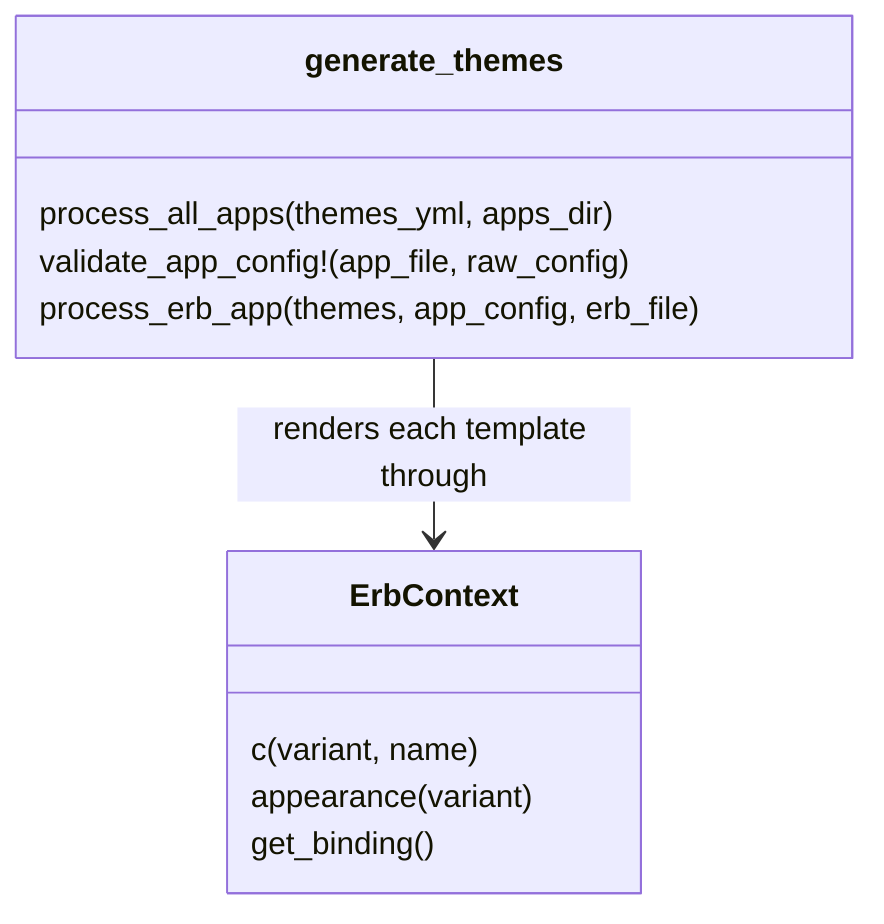
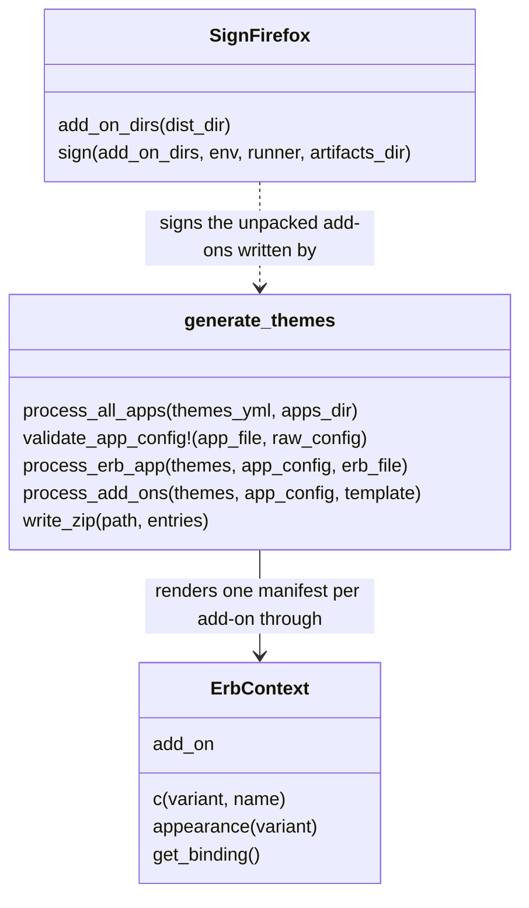
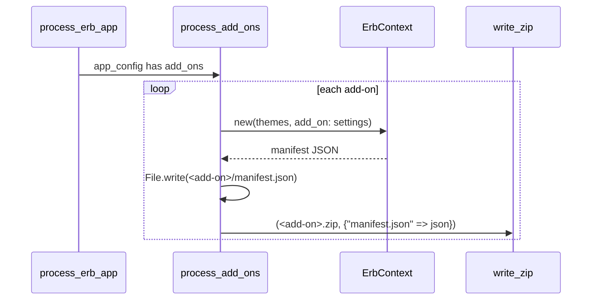

# Plan: Firefox theme add-on

From `intent.md` (2026-10-20). Status: accepted.

## Design

### Domain terms

There is no `GLOSSARY.md` yet. No word of the intent conflicts with an agreed term.

- **Variant** (existing): one entry of `themes.yml` — `dark`, `light`, `black` or `white`.
- **Add-on** (new): one Firefox theme extension. It pairs a `theme` variant (used in light mode) with a `dark_theme` variant (used in dark mode), and has a fixed name, id and version. Two add-ons exist: `solunized-light-dark` and `solunized-white-black`.
- **Unpacked add-on** (new): the directory `dist/firefox/<add-on>/` with `manifest.json` at its root. `web-ext sign` and `about:debugging` read it.
- **Add-on zip** (new): `dist/firefox/<add-on>.zip`, the same `manifest.json` at the archive root.
- **Colour mapping** (new): the 38 current MDN `theme.colors` keys, each mapped to one palette name. It lives once, in `applications/firefox/template.json.erb`, and serves both sections of a manifest.
- **Signing script** (new): `sign_firefox.rb`. It wraps `npx web-ext sign --channel unlisted`. Only Etienne runs it.

### Diagrams

Before: `generate_themes.rb` is top-level functions plus `ErbContext`. `process_erb_app` has two modes: `per_theme: true` (one file per variant) and `per_theme: false` (one combined file).



After: a third mode, chosen by the `add_ons` key. One zip writer. One separate signing script with no link to the generator.





### Signatures

`generate_themes.rb` (changed):

```ruby
# ErbContext: resolves palette names for one template render; it now also exposes the add-on being rendered.
#: (Hash[String, untyped] themes, ?String? variant, ?Hash[String, untyped]? theme_data, ?plutil_command: String, ?plutil_env: Hash[String, String], ?add_on: Hash[String, String]?) -> void
def initialize(themes, variant = nil, theme_data = nil, plutil_command: "plutil", plutil_env: {}, add_on: nil)
#: () -> Hash[String, String]?
attr_reader :add_on

# Validates an application config; an add_ons config needs no per_theme, but needs version and filename.
#: (String app_file, Hash[String, untyped] raw_config) -> [String, Hash[String, untyped], String]
def validate_app_config!(app_file, raw_config)

# Writes <output_dir>/<add-on>/<filename> and <output_dir>/<add-on>.zip for each add-on.
#: (Hash[String, untyped] themes, Hash[String, untyped] app_config, ERB template) -> void
def process_add_ons(themes, app_config, template)

# Writes a stored (uncompressed) zip with a fixed 1980-01-01 timestamp, so a re-run gives the same bytes.
#: (String path, Hash[String, String] entries) -> String
def write_zip(path, entries)

# Writes one add-on's directory and zip from the same manifest string.
#: (String output_dir, String slug, String filename, String manifest) -> void
def write_add_on(output_dir, slug, filename, manifest)

# The whole stored-zip byte string for the entries.
#: (Hash[String, String] entries) -> String
def zip_archive(entries)

# The local record and the central directory record of one entry.
#: (String name, String data, Integer offset) -> [String, String]
def zip_entry(name, data, offset)

#: (String name, String data, Integer crc) -> String
def zip_local_header(name, data, crc)

#: (String name, String data, Integer crc, Integer local_offset) -> String
def zip_central_header(name, data, crc, local_offset)

#: (Integer count, Integer central_size, Integer central_offset) -> String
def zip_end_record(count, central_size, central_offset)

# Config checks called by validate_app_config!.
#: (String app_file, String app_name, Hash[String, untyped] app_config) -> void
def validate_per_theme!(app_file, app_name, app_config)

#: (String app_file, String app_name, Hash[String, untyped] app_config) -> void
def validate_add_ons!(app_file, app_name, app_config)

#: (String prefix, String slug, untyped settings) -> void
def validate_add_on!(prefix, slug, settings)

#: (untyped value) -> bool
def present_string?(value)
```

- `process_erb_app` gets one new first branch: `return process_add_ons(themes, app_config, template) if app_config.key?("add_ons")`.
- `validate_app_config!` delegates the add-on checks to a helper `validate_add_ons!(app_file, app_name, app_config)`. It raises unless `add_ons` is a non-empty mapping, each entry has non-empty `name`, `id`, `theme` and `dark_theme` strings, and the app has a non-empty `version` and `filename`. The `per_theme` check applies only when `add_ons` is absent.
- `process_add_ons` merges the app `version` into each add-on's settings and passes the add-on slug as `"slug"`, so the template reads one hash.
- `write_zip` helpers: `zip_local_header`, `zip_central_header`, `zip_end_record`. Records are built with `Array#pack("VvvvvvVVVvv…")`. The CRC comes from `Zlib.crc32`. Method 0 (stored), DOS time 0, DOS date `0x21`.
- `generate_themes.rb` adds `require "json"` and `require "zlib"`.

`applications/firefox/template.json.erb` (new): a `<% mapping = { "frame" => "bg_0", … } -%>` block of 38 entries, then one `<%= JSON.pretty_generate(…) %>` of this hash:

- `manifest_version: 2`, `name: add_on["name"]`, `version: add_on["version"]`.
- `browser_specific_settings.gecko`: `id: add_on["id"]`, `data_collection_permissions: { required: ["none"] }`.
- `theme.colors`: `mapping.transform_values { |name| c(add_on["theme"], name) }`.
- `dark_theme.colors`: the same with `add_on["dark_theme"]`.

`sign_firefox.rb` (new, at the repository root, shaped like `preview_palette.rb`):

```ruby
# Signs each unpacked Firefox add-on through web-ext on the unlisted channel; refuses without AMO credentials.
module SignFirefox
  CREDENTIALS = %w[WEB_EXT_API_KEY WEB_EXT_API_SECRET].freeze
  class MissingCredentialsError < RuntimeError; end
  class SigningFailedError < RuntimeError; end

  class << self
    # The generated directory of each add-on in configuration.yml, so a directory left over from a removed
    # add-on is never signed; raises when one is missing.
    #: (?String dist_dir, ?slugs: Array[String]) -> Array[String]
    def add_on_dirs(dist_dir = "dist/firefox", slugs: configured_slugs)

    # Raises MissingCredentialsError naming each missing variable before any command runs; else signs each directory.
    #: (Array[String] add_on_dirs, ?env: Hash[String, String], ?runner: ^(Hash[String, String], Array[String]) -> bool?, ?artifacts_dir: String) -> void
    def sign(add_on_dirs, env: ENV.to_h, runner: ->(env, command) { system(env, *command) }, artifacts_dir: "dist/firefox/signed")
  end
end
```

- `add_on_dirs` takes the slugs from `applications/firefox/configuration.yml` and returns `<dist_dir>/<slug>` for each. It raises `SigningFailedError` naming every slug whose `manifest.json` is missing. A removed add-on's directory and `dist/firefox/signed/` are never listed, so a later run never signs stale output or its own output.
- Each command is `["npx", "--yes", "web-ext@10", "--no-config-discovery", "sign", "--channel", "unlisted", "--source-dir", dir, "--artifacts-dir", artifacts_dir]`. `--no-config-discovery` stops a home or local `web-ext` config from changing the signing inputs.
- The runner gets the `env` hash and the command. The default runner calls `system(env, *command)`, so the checked hash is the one `npx` sees.
- The credentials never go on the command line. `web-ext` reads `WEB_EXT_API_KEY` and `WEB_EXT_API_SECRET` from that environment.
- A runner result other than `true` raises `SigningFailedError` naming the directory.
- The `if __FILE__ == $PROGRAM_NAME` block calls `sign(add_on_dirs)`, rescues `MissingCredentialsError` and `SigningFailedError` as `error`, and calls `abort(error.message)`.

Not checked: the repository has no Gemfile, Steep or rbs_rails. The `#:` comments are documentation.

### Complexity

- Generation: per add-on, 76 `c()` hash lookups (38 keys × 2 variants), one JSON render, one file write and one zip write. Two add-ons in total. No network, no subprocess, no database.
- `write_zip`: O(bytes of the entries), one CRC pass and one write.
- Signing: one `npx` subprocess per unpacked add-on. Only Etienne runs it.

### Invariants

- Every value in `theme.colors` and `dark_theme.colors` is a `#RRGGBB` string from that variant in `themes.yml`. Enforced by `ErbContext#c`, which raises on an unknown variant or colour name, and by the template, which holds no hex.
- `theme` and `dark_theme` hold exactly the same 38 current keys and no deprecated key. Enforced by the single colour mapping in the template.
- `generate_themes.rb` never signs, never starts a subprocess on the add-on path and never uses the network. Enforced by construction: it does not require `sign_firefox.rb`, and `write_zip` uses only `Zlib`.
- The signing script runs no command while a credential is missing. Enforced by the guard at the top of `SignFirefox.sign`.
- No credential value appears in a signing command. Enforced by passing them through the environment only.
- The add-on id never changes. It is a literal in `applications/firefox/configuration.yml`, never derived from the slug.

### Alternatives

- **Chosen: an `add_ons` mode in the generator.** One new config key selects a third mode. Add-on facts (name, id, variants) and the version live in `configuration.yml`. The whole manifest lives in one template. Cost: one more branch in `process_erb_app` and an `add_on` reader on `ErbContext`.
- **Rejected: overload `per_theme: false`.** The `variant_pairs` key would silently change what `per_theme: false` means. That is connascence of meaning in the config. The version would be a literal in the template.
- **Rejected: two nested application entries plus a partial.** `applications/firefox/light-dark/` and `white-black/` each use `per_theme: false` and render a shared partial through a new `ErbContext#partial`. Rejected because the "one directory per application" layout bends, the add-on facts sit in template arguments instead of config, and `partial` can render any path.
- **Rejected: four new classes (`FirefoxAddOn`, `ColorTemplate`, `ZipWriter`, `AddOnSigner`) in `lib/`.** The deepest modules, but the manifest structure splits between Ruby and ERB, a new `lib/` directory appears, and the diff is the largest. The generator is procedural today; the signing script still gets its own module.

## Design decisions

- **The signing script signs the unpacked directories, not the zips.** The intent says "wraps `npx web-ext sign --channel unlisted` for each zip". `web-ext sign` takes a source directory (`--source-dir`), not a zip. So the generator writes both an unpacked add-on and its zip, from the same JSON string. The zip stays the artefact for `about:debugging` and for a manual upload. The behaviour Etienne asked for — one signed `.xpi` per add-on — does not change.
- **Pin `web-ext@10` and pass `--yes`.** Version 10 is the one that needs Node.js 22, as the intent states. `--yes` stops `npx` from prompting for the install.
- **`manifest_version: 2`.** Themes work with manifest version 2 or later. Version 2 needs no extra keys.
- **`data_collection_permissions: { required: ["none"] }`.** AMO requires it for new extensions since November 2025. The documentation does not say whether themes are exempt. The key is harmless for a theme.
- **One shared `version` in `configuration.yml`, starting at `1.0.0`.** AMO rejects a repeated version, so Etienne bumps it before each signing. The README says so.
- **Add-on names and ids.** `Solunized Light & Dark` with id `solunized-light-dark@eirvandelden.github.io`; `Solunized White & Black` with id `solunized-white-black@eirvandelden.github.io`. An id is fixed after the first signing.
- **Colour mapping.** The table below. Backgrounds step from `bg_0` (frame) to `bg_1` (toolbar) to `bg_2` (separators); text uses `fg_1`, secondary text `fg_0`; the accent is `blue`. Selected tab equals toolbar, as in Firefox's own themes.

  | Keys | Palette name |
  |------|--------------|
  | `frame`, `frame_inactive`, `toolbar_field`, `toolbar_field_focus`, `ntp_background` | `bg_0` |
  | `toolbar`, `tab_selected`, `popup`, `sidebar`, `ntp_card_background` | `bg_1` |
  | `toolbar_top_separator`, `toolbar_bottom_separator`, `toolbar_vertical_separator`, `toolbar_field_border`, `button_background_hover`, `button_background_active`, `popup_border`, `popup_highlight`, `sidebar_border` | `bg_2` |
  | `tab_background_text`, `icons` | `fg_0` |
  | `tab_text`, `toolbar_text`, `bookmark_text`, `toolbar_field_text`, `toolbar_field_text_focus`, `popup_text`, `popup_highlight_text`, `sidebar_text`, `ntp_text` | `fg_1` |
  | `tab_line`, `tab_loading`, `toolbar_field_border_focus`, `toolbar_field_highlight`, `icons_attention`, `sidebar_highlight` | `blue` |
  | `toolbar_field_highlight_text`, `sidebar_highlight_text` | `bg_0` |

  Thirty-eight keys in total. The intent says the nine Firefox Color keys (`toolbar`, `toolbar_text`, `frame`, `tab_background_text`, `toolbar_field`, `toolbar_field_text`, `tab_line`, `popup`, `popup_text`) take "the values Etienne enters by hand now". Those values are not in the intent or the repository. **Gate before step 4:** Etienne gives the palette name for each of the nine keys, or accepts the rows above for them. Step 4 uses his answer; only the rows for the nine keys can change, and the other 29 stay as above.
- **CI runs the new test file.** `.github/workflows/ci.yml` gets one step, `ruby test/sign_firefox_test.rb`, after the `preview_palette` step. **Gate before step 7:** playbook rule 13 requires Etienne's explicit approval for this edit. Without it the step is left out and the gap is reported as an open item in the pull request.
- **No conflict with `intent.md`'s `## Decisions`.** Light and dark share one add-on, black and white share the second, manifest only, full key list, signing in a separate script run only by Etienne, the generator zips and never signs.

## Integration points

- Firefox's WebExtension theme manifest (`theme`, `dark_theme`, `browser_specific_settings.gecko`).
- `web-ext` 10 through `npx`, Node.js 22 or later — signing script only.
- AMO signing API, unlisted channel — reached only by `web-ext` in Etienne's run.
- `about:debugging` → "Load Temporary Add-on" — reads the zip or the unpacked `manifest.json`.
- GitHub Actions CI (`.github/workflows/ci.yml`), test job.

## Files that change

- `generate_themes.rb` — `require "json"` and `"zlib"`; `ErbContext` gets `add_on:`; `validate_app_config!` accepts the `add_ons` mode through `validate_add_ons!`; `process_erb_app` branches to the new `process_add_ons`; new `write_zip` and its three header helpers.
- `applications/firefox/configuration.yml` — new: `output_dir: dist/firefox`, `filename: manifest.json`, `version: "1.0.0"`, and the two `add_ons` entries.
- `applications/firefox/template.json.erb` — new: the colour mapping and the manifest.
- `sign_firefox.rb` — new: `SignFirefox` module and entry point.
- `test/generate_themes_test.rb` — new `FirefoxApplicationTest` and `WriteZipTest`; add-on tests in `ProcessErbAppTest` and `ProcessAllAppsTest`; Firefox asserts in `FullApplicationIntegrationTest`.
- `test/sign_firefox_test.rb` — new.
- `.github/workflows/ci.yml` — one test step, only with Etienne's approval (rule 13).
- `README.md` — Firefox row in "Supported applications"; the `add_ons` mode and `add_on` helper under "Adding a new application"; Node.js 22 as an optional requirement; a "Signing the Firefox add-ons" section: how to create the AMO API key and secret (addons.mozilla.org → Developer Hub → Manage API Keys), export `WEB_EXT_API_KEY` and `WEB_EXT_API_SECRET`, bump `version`, run `ruby generate_themes.rb` then `ruby sign_firefox.rb`, and install `dist/firefox/signed/*.xpi` through `about:addons` → "Install Add-on From File"; plus the `about:debugging` temporary load for a quick check.
- `AGENTS.md` (`CLAUDE.md` links to it) — the `add_ons` mode in Domain; `ruby sign_firefox.rb` (Etienne only, never an agent) and `ruby test/sign_firefox_test.rb` in Commands.

## Order of work

1. Write `FirefoxApplicationTest` in `test/generate_themes_test.rb`, with its own frozen `FIREFOX_COLOR_KEYS` list of the 38 MDN keys, independent of the template. It generates from the real `applications/firefox/` config and template into a temporary directory and checks every acceptance criterion about the output. Run it and watch it fail: the config does not exist.
2. Write `WriteZipTest`, then `write_zip` and its helpers. Green.
3. Write the add-on tests in `ProcessErbAppTest` and `ProcessAllAppsTest` with a fixture template. Add `ErbContext#add_on`, `validate_add_ons!`, `process_add_ons` and the `process_erb_app` branch. Green.
4. After the nine-key gate in `## Design decisions`, add `applications/firefox/configuration.yml` and `template.json.erb`. `FirefoxApplicationTest` goes green.
5. Add the Firefox asserts to `FullApplicationIntegrationTest`. Green.
6. Write `test/sign_firefox_test.rb`, then `sign_firefox.rb`. Green.
7. Add the CI step, only after Etienne's approval (gate in `## Design decisions`).
8. Update `README.md` and `AGENTS.md`.
9. Run `ruby test/generate_themes_test.rb`, `ruby test/preview_palette_test.rb` and `ruby test/sign_firefox_test.rb`, then `ruby generate_themes.rb`. Check `git status` shows no change to `docs/colors.md` or `docs/slack.md`. Unzip-check each zip with `unzip -l dist/firefox/<add-on>.zip`.
10. Optional, when Node.js 22+ is present: `npx --yes web-ext@10 lint --source-dir dist/firefox/<add-on>` for each add-on. Lint does not submit anything. Never run `sign_firefox.rb` or `web-ext sign`.

## Risks

- **Mapping readability.** A colour pair can look wrong on screen even when the tests pass. Etienne's check through `about:debugging` is the final proof.
- **AMO rejects the manifest at signing.** For example over `data_collection_permissions` or the id format. Only Etienne's signing run shows it. Step 10's lint lowers the risk.
- **Hand-written zip format.** A wrong header breaks the install. Mitigated by the read-back test and by `unzip -l` in step 9.
- **Overwritten version.** Re-signing an unchanged `version` fails on AMO. The README tells Etienne to bump it.
- **Unpacked directory and zip drift.** Both are written from one JSON string in one method.
- **CI does not run the signing tests.** If Etienne does not approve the `ci.yml` step, the tests run only locally.

Out of scope: the listed channel and the public store; running the signing script anywhere but Etienne's own shell; storing or fetching AMO credentials; `userChrome.css`, `user.js` and other profile files; theme images and `theme.properties`; the deprecated keys `tab_background_separator` and `toolbar_field_separator`; new colours in `themes.yml`; a `GLOSSARY.md`.

## Proof

- Running the generator writes a light+dark manifest and a white+black manifest under `dist/firefox/` → `test/generate_themes_test.rb` `FirefoxApplicationTest#test_writes_a_manifest_per_add_on`
- `theme.colors.frame` equals the light background and `dark_theme.colors.frame` the dark background → `test/generate_themes_test.rb` `FirefoxApplicationTest#test_light_dark_frames_use_the_light_and_dark_backgrounds`
- In the white+black manifest, the same keys equal the white and black backgrounds → `test/generate_themes_test.rb` `FirefoxApplicationTest#test_white_black_frames_use_the_white_and_black_backgrounds`
- Every manifest is valid JSON, each section has every current key, every value is a `#RRGGBB` from `themes.yml` → `test/generate_themes_test.rb` `FirefoxApplicationTest#test_every_current_key_has_a_colour_of_its_variant` (exact key-set equality with the test's own `FIREFOX_COLOR_KEYS`, not the template's mapping)
- In the dark variant, `toolbar_text` and `toolbar` differ → `test/generate_themes_test.rb` `FirefoxApplicationTest#test_dark_toolbar_text_differs_from_toolbar`
- Each manifest names its add-on → `test/generate_themes_test.rb` `FirefoxApplicationTest#test_each_add_on_has_its_own_name_and_id`
- Each add-on exists as a `.zip` with `manifest.json` at its root → `test/generate_themes_test.rb` `FirefoxApplicationTest#test_each_add_on_zip_holds_its_manifest_at_the_root`
- The signing script refuses without `WEB_EXT_API_KEY` and `WEB_EXT_API_SECRET` and names the missing one; its tests use no network and no `npx` → `test/sign_firefox_test.rb` `SignFirefoxTest#test_refuses_without_the_api_key_and_names_it`, `#test_refuses_without_the_api_secret_and_names_it`, `#test_runs_no_command_while_a_credential_is_missing`
- The README explains the AMO credentials, the script and the `.xpi` install → check: read the "Signing the Firefox add-ons" section of `README.md` against these three steps.
- A temporary load through `about:debugging` applies the dark colours in dark mode and the light colours otherwise → check: manual, by Etienne — load each zip, switch the macOS appearance, watch the frame colour follow.
- The README lists Firefox in the supported applications table → check: `grep -n "applications/firefox/configuration.yml" README.md`
- Invariant: no deprecated key in either section, enforced by the single colour mapping → `test/generate_themes_test.rb` `FirefoxApplicationTest#test_has_no_deprecated_keys`
- Invariant: no credential value in a signing command, enforced by passing them through the environment → `test/sign_firefox_test.rb` `SignFirefoxTest#test_keeps_the_credentials_out_of_the_command` (asserts the runner's `env` holds both credentials and no command argument equals one)
- Invariant: the unpacked manifest and the zip hold the same bytes, enforced by `process_add_ons` → `test/generate_themes_test.rb` `AddOnProcessingTest#test_add_on_zip_holds_the_same_manifest_as_its_directory`

Per changed file, the unit tests expected, named as behaviour:
- `generate_themes.rb`: `write_zip writes each entry at the archive root with a matching CRC`, `write_zip gives the same bytes on every run`, `process_erb_app writes one directory and one zip per add-on`, `the add-on template sees its add-on settings and the shared version`, `process_all_apps rejects an add-on without an id`, `process_all_apps rejects add_ons without a version`, `process_all_apps generates the Firefox add-ons with every other application` (in `FullApplicationIntegrationTest`).
- `sign_firefox.rb`: `SignFirefox.sign signs each add-on directory on the unlisted channel`, `refuses without the api key and names it`, `refuses without the api secret and names it`, `runs no command while a credential is missing`, `keeps the credentials out of the command`, `raises when a signing run fails`, `passes --no-config-discovery`, `SignFirefox.add_on_dirs lists each unpacked add-on`, `skips the signed directory`, `refuses when no add-on was generated`.

Test setup: the existing `THEMES` fixture and a fixture add-on template for the generator unit tests; the real `themes.yml` and `applications/firefox/` for `FirefoxApplicationTest`; a temporary `dist_dir`, an `env:` hash with placeholder strings such as `"test-key"`, and a recording lambda as `runner:` for the signing tests. A test reads a zip back with `String#unpack1` and `byteslice`, so no unzip tool is needed.

---
Domain skills applied: software-design, glossary, diagrams, ruby-style, object-oriented-design, dependencies (web-ext via npx, approved in intent, not added to the repo).

## Critique

### Round 1 (codex exec -p terra)

- The nine Firefox Color values stay unproven; the plan swaps in its own proposal instead of Etienne's hand-entered values → fixed (the nine keys are named, and a gate before step 4 asks Etienne for their palette names or his acceptance of the proposed rows)
- The injected `env:` never reaches `npx`, because the default runner calls `system` with the real environment only → fixed (the runner takes `env` and the command and passes both to `system`; the credentials test asserts the runner's `env` holds them)
- `add_on_dirs` is underspecified and could sign its own output in `dist/firefox/signed` → fixed (it globs `<dist_dir>/*/manifest.json`; a `skips the signed directory` unit test is added)
- User-level `web-ext` config discovery can change the signing inputs → fixed (the command passes `--no-config-discovery`, with a unit test)
- The every-key proof needs an expected-key set independent of the template mapping → fixed (`FirefoxApplicationTest` defines its own frozen 38-key `FIREFOX_COLOR_KEYS` and asserts exact equality for both sections)
- Verification names two test files where three exist, and the CI edit reads as optional → fixed (step 9 names all three commands; the CI step is an explicit approval gate before step 7)
