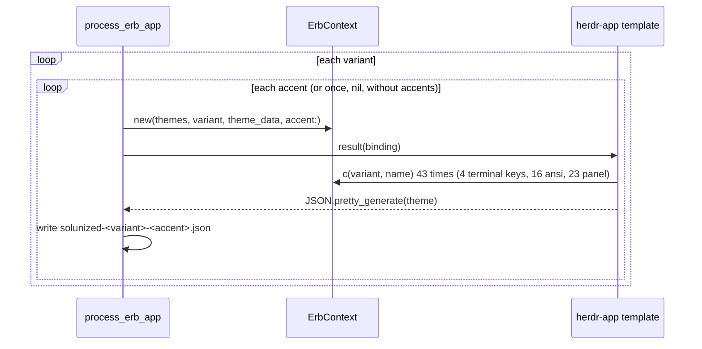

# Plan: herdr-app theme template

From `intent.md` (2026-11-11). Status: accepted.

## Design

### Domain terms

The repository has no glossary. Terms used here:

- **Variant**: one theme in `themes.yml` (dark, light, black, white).
- **Palette name**: a color key of a variant (`bg_0` … `br_violet`); `ErbContext#c(variant, name)` resolves it.
- **Application target**: an `applications/<app>/configuration.yml` with its one `template.<ext>.erb`.
- **Accent** (new): the palette name a per-theme target renders as its accent. A per-theme target with `accents` writes one file per variant and accent.
- **Terminal colors** (new): the top-level `background`, `foreground`, `selection`, `cursor` and 16-entry `ansi` of a herdr-app theme file.
- **Panel color** (new): one of the 23 names herdr-app 0.1.15 documents for a theme's `colors` object (its home `AGENTS.md`, `theme()`): background, canvas, chrome, surface, popover, raised, hover, selected, border, input, foreground, muted, dim, accent, accent_foreground, solid, solid_foreground, selection, working, blocked, done, idle, unknown.

### Diagrams

```mermaid
classDiagram
  class process_erb_app {
    +process_erb_app(themes, app_config, erb_file)
  }
  class ErbContext {
    +c(variant, name) String
    +variant String
    +accent String?
  }
  class HerdrAppConfiguration {
    output_dir dist/herdr-app
    per_theme true
    accents [blue, orange]
    filename_pattern solunized-%{variant}-%{accent}.json
  }
  class HerdrAppTemplate {
    ansi_names 16 palette names
    panel_names 23 panel color to palette name
  }
  process_erb_app --> HerdrAppConfiguration : reads
  process_erb_app --> ErbContext : one per variant and accent
  process_erb_app --> HerdrAppTemplate : renders
  HerdrAppTemplate --> ErbContext : c(variant, name), accent
```



### Signatures

`generate_themes.rb`:

- `ErbContext` — looks up a variant's colors for a template. New keyword `accent:` (default `nil`), its reader, and a method that names its own output file (tell, don't ask):
  - `#: (any_hash, ?String?, ?any_hash?, ?plutil_command: String, ?plutil_env: str_hash, ?add_on: str_hash?, ?accent: String?) -> void` above `def initialize`. This makes seven parameters, one more than today; `rubocop-rails-omakase` turns `Metrics/ParameterLists` off, and every new one is an optional keyword. The annotation and the parameter list each span several lines to stay under 120 characters; the `#:` continuation lines are indented, which `rbs-inline` reads as one signature.
  - `attr_reader :accent #: String?` — the palette name of the accent being rendered; nil for a target without `accents`.
  - `#: (String pattern) -> String` above `def filename(pattern)` — formats the pattern with `variant`, `display_name` and `accent`.
- `process_erb_app(themes, app_config, erb_file, ...)` — unchanged signature. Inside the existing `themes.each`, it loops over `(app_config["accents"] || [nil])`, builds one `ErbContext` per variant and accent, and writes `File.join(output_dir, ctx.filename(pattern))`. No new helper and no `Data.define`. Without `accents` it renders once per variant, exactly as today.
- `validate_per_theme!(app_file, app_name, app_config)` — unchanged signature. It calls a new `validate_accents!(prefix, app_config)` (with an `accent_names?(value)` predicate), which keeps each method short. With `accents` present it refuses: `per_theme: false`; a value that is not a non-empty array of non-empty strings; duplicate accents; a `filename_pattern` without `%{accent}`. Without `accents` it refuses a `filename_pattern` that holds `%{accent}`.
- `validate_add_ons!(app_file, app_name, app_config)` — unchanged signature. Also refuses `accents`.

`applications/herdr-app/configuration.yml` (new):

```yaml
herdr-app:
  output_dir: dist/herdr-app
  per_theme: true
  accents: [blue, orange]
  filename_pattern: "solunized-%{variant}-%{accent}.json"
```

`applications/herdr-app/template.json.erb` (new): two literals and one `JSON.pretty_generate` call, as `applications/firefox/template.json.erb` does. No hex color in the template.

```erb
<%
  # Terminal colors: applications/ghostty/template.config.erb's mapping, slot for slot.
  terminal_names = { "background" => "bg_0", "foreground" => "fg_1", "selection" => "bg_1", "cursor" => "orange" }
  ansi_names = %w[fg_0 red green yellow blue magenta cyan dim_0 fg_1 br_red br_green br_yellow br_blue br_magenta br_cyan fg_1]
  # Panel colors: every name herdr-app 0.1.15 documents, mapped to a palette name.
  panel_names = { "background" => terminal_names["background"], "canvas" => "bg_1", ..., "accent" => accent, ... }
-%>
<%= JSON.pretty_generate(
  **terminal_names.transform_values { |name| c(variant, name) },
  "ansi" => ansi_names.map { |name| c(variant, name) },
  "colors" => panel_names.transform_values { |name| c(variant, name) }
) %>
```

Panel color mapping (same palette name in every variant):

| Panel color | Palette name | Why |
|---|---|---|
| background | `terminal_names["background"]` (bg_0) | herdr-app also paints terminals with it; Ghostty's background; herdr TUI `active_row_bg`; Zed editor |
| canvas | bg_1 | behind the cards; herdr TUI `panel_bg` |
| chrome | bg_1 | sidebars and bars; herdr TUI `sidebar_bg` |
| surface | bg_1 | herdr TUI `surface_dim` |
| popover | bg_1 | Zed elevated surface; the border separates it |
| raised | bg_0 | a lifted item takes the card color |
| hover | bg_2 | Zed `element.hover` |
| selected | bg_0 | herdr TUI `active_row_bg` |
| border | bg_2 | Zed border; herdr TUI `overlay0` |
| input | dim_0 | the stronger border, one step above `bg_2` |
| foreground | `terminal_names["foreground"]` (fg_1) | Ghostty's foreground |
| muted | fg_0 | Zed `text.muted` |
| dim | dim_0 | Zed placeholder text |
| accent | the accent (`blue` or `orange`) | the intent |
| accent_foreground | bg_0 | readable on blue and orange in every variant; `fg_1` on dark blue is about 2.4:1 |
| solid | fg_1 | a neutral primary button ("ink on paper"), so blue or orange stays the accent only |
| solid_foreground | bg_0 | high contrast on `fg_1` |
| selection | `terminal_names["selection"]` (bg_1) | Ghostty's `selection-background` |
| working | br_yellow | Zed modified; `br_*` is the higher-contrast step in both modes |
| blocked | br_red | Zed error |
| done | br_green | Zed created |
| idle | dim_0 | Zed hidden |
| unknown | dim_0 | no palette meaning; win98.json also makes idle and unknown one grey |

Not checked: solunized declined Steep and rbs_rails (no `Steepfile`); signatures are inline RBS comments only.

### Complexity

Per file: 43 `c()` hash lookups (4 terminal keys, 16 `ansi`, 23 panel colors), one `JSON.pretty_generate`, one write. 4 variants × 2 accents = 8 files. No database, no shell command, no network.

### Invariants

1. Each herdr-app file parses as JSON: `JSON.pretty_generate` builds the whole document. → `test_each_file_parses_as_json`.
2. `ansi` holds exactly 16 colors: a 16-name literal, and `c()` raises on an unknown name. → `test_ansi_holds_sixteen_colors`.
3. Terminal colors, `ansi[0..15]`, and `colors.background`, `colors.foreground` and `colors.selection` (herdr-app paints terminals with these too) equal the rendered Ghostty file's `background`, `foreground`, `cursor-color`, `selection-background` and `palette` 0–15 in every variant and accent. → `test_terminal_colors_equal_the_ghostty_colors`.
4. `colors` holds exactly the 23 documented panel color names. → `test_colors_holds_exactly_the_documented_panel_color_names`.
5. Each panel color has the palette name of the table above. → `test_maps_each_panel_color_to_its_palette_name`.
6. The orange file equals the blue file except `colors.accent`. → `test_orange_file_differs_from_blue_only_in_the_accent`.
7. Every color is a lowercase `#rrggbb` from its variant's palette. → `test_every_color_comes_from_the_variant_palette`.
8. `accent_foreground` on `accent` and `solid_foreground` on `solid` reach 4.5:1 (WCAG AA) in every file. → `test_accent_and_solid_text_meet_wcag_aa`.
9. The template holds no hex color. → `test_the_template_holds_no_hex_colour`.
10. A target with `accents` names `%{accent}` in its pattern and lists each accent once, so no file overwrites another; a target without `accents` never names `%{accent}`. → `AccentsConfigValidationTest`.
11. A target without `accents` renders exactly as before: the herdr TUI, Ghostty and every other existing test stays green, and the integration count of `out/herdr/*.toml` stays 4.

### Alternatives

- **A — accent only (rejected).** Set the terminal colors and `colors.accent`; let herdr-app derive every other panel color. Smallest, but herdr-app's derivation picks tints that are not in `themes.yml`, and it may derive borders from `ansi[0]`/`ansi[8]`, which Ghostty's mapping makes light in a dark variant. It does not meet the intent's "backgrounds, borders, text and agent status colors from the palette".
- **B — full palette, one file per variant (rejected).** The chosen mapping, but blue only. It leaves the work-space orange to the dotfiles repository, which would have to copy the colors and drift.
- **C — two application targets, `herdr-app` and `herdr-app-orange` (rejected).** No generator change, but the 43-name mapping lives in two templates, kept equal only by a test.
- **D — full palette with an `accents` option on per-theme targets (chosen).** One template, one mapping, eight files; the generator change is small and opt-in, and every existing target renders unchanged.

## Design decisions

- File names carry the accent for both files (`-blue`, `-orange`), so the pair is symmetric and the pattern needs no empty-suffix special case. The intent was updated to these names before the plan.
- Undocumented names that shipped files use (`ring` in win98.json, `terminal_foreground` in the Terminals layout) stay out: no documentation backs them, and herdr-app derives them.
- The accent is the plain `blue`/`orange`, not `br_*`: the intent's acceptance criteria name `#4191f4`/`#0068c9` and `#ea8347`/`#b05015`.
- `AGENTS.md`'s application list (its first paragraph) and its Domain paragraph get herdr-app and the `accents` key, since agents read that file first. The README gets the table row and the `accents` key in its "add an application" list.
- The generator change is the cost of the intent decision "generate the orange-accent files in solunized too" together with rejecting alternative C. It grows the change beyond the intent's list of affected files (`generate_themes.rb`, `AGENTS.md`), opt-in only: every existing target renders unchanged. No conflict with `intent.md`'s Decisions.
- `ErbContext` gets a seventh, optional parameter rather than a parameter object: the existing six already live there, and the linter does not limit them.

## Integration points

- herdr-app 0.1.15's theme format (`themes/<name>.json`). The dotfiles phase 4 pull request links `dist/herdr-app/*.json` into herdr-app's `themes/` and switches between the blue and orange files.
- CI: the test job, the regenerate-and-`git diff` job (no committed output changes) and the rubocop job.

## Files that change

- `generate_themes.rb` — `ErbContext` `accent:` keyword, reader and `#filename`; `process_erb_app` loops over `accents` inside `themes.each`, with no new helper; `validate_per_theme!` checks `accents` through `validate_accents!`; `validate_add_ons!` refuses `accents`.
- `applications/herdr-app/configuration.yml` — new target.
- `applications/herdr-app/template.json.erb` — new template.
- `test/generate_themes_test.rb` — `ProcessErbAppTest` accent tests; new `AccentsConfigValidationTest` (modelled on `AddOnConfigValidationTest`); new `HerdrAppApplicationTest` after `HerdrApplicationTest`; two small test modules shared by test classes, `WcagContrast` (`contrast_ratio`, moved out of `SlackApplicationTest`) and `GhosttyConfig` (parses a rendered Ghostty file into `background`, `foreground`, `cursor-color`, `selection-background` and `palette`; replaces `GlowApplicationTest#ghostty_palette`), included where used; one count line in `FullApplicationIntegrationTest`.
- `README.md` — `accents` in the configuration key list; in the template step, "a template whose target has `accents` gets `accent`, the palette name being rendered"; the table row `| Herdr app | [`applications/herdr-app/configuration.yml`](applications/herdr-app/configuration.yml) |` after Herdr.
- `AGENTS.md` — herdr-app in the app list; `accents` and the template's `accent` in the Domain paragraph.
- Not affected: `themes.yml`, `applications/herdr/*`, `applications/ghostty/*`, `docs/colors.md`, `docs/slack.md`.

## Order of work

1. Write the acceptance test `HerdrAppApplicationTest#test_writes_two_json_files_per_variant`, run it, watch it fail (no target yet).
2. Write the `ProcessErbAppTest` accent tests and the `accents` validation tests; watch them fail.
3. Add `accent:` to `ErbContext`, the accents loop and the validation in `generate_themes.rb`; run the narrow tests green.
4. Add the configuration and the template; write the remaining `HerdrAppApplicationTest` tests; move `contrast_ratio` to the top level; run them green.
5. Add the integration count line; run the whole file: `ruby test/generate_themes_test.rb`, then `ruby test/preview_palette_test.rb` and `ruby test/sign_firefox_test.rb`.
6. Update `README.md` and `AGENTS.md`.
7. `ruby generate_themes.rb`; `git status` shows no change to `docs/`. `bin/rubocop` clean.
8. Visual check, in a sandbox herdr-app only (never Etienne's window). The home path must be short, or the socket path is too long:
   - `mkdir -p <scratch>/hac4-home/themes && ln -sfn <scratch>/hac4-home /tmp/hac4h`, then copy `dist/herdr-app/solunized-{light,dark}-{blue,orange}.json` into `/tmp/hac4h/themes/`.
   - Start it: `HERDR_APP_HOME=/tmp/hac4h HC_SESSION=hac4 /Applications/Herdr.app/Contents/MacOS/Herdr &` and note the pid. `HC_SESSION` picks the herdr-core session, so the sandbox never touches Etienne's cores.
   - `export HERDR_APP_HOME=/tmp/hac4h; herdr-app do space.new --name check; herdr-app do app.theme --name solunized-light-blue; herdr-app shot <scratch>/light.png`; repeat with `solunized-dark-blue` after setting `"appearance": "dark"` in `/tmp/hac4h/settings.json`.
   - Sample pixels with a scratch Ruby script that reads the PNG with `Zlib` (standard library, no gem): one inside the terminal against `bg_0`, one in the sidebar against `bg_1`. Also check that a selected sidebar row is visible.
   - Stop the sandbox window by its pid. The `hac4` core and holder stay for the dotfiles phase 4 checks.

## Risks

- herdr-app renames or adds a panel color: an unknown name is ignored and a missing one is derived. The pinned list only makes the change deliberate.
- Palette steps are shared: canvas, chrome, surface and popover are all `bg_1`; hover and border are `bg_2`. A hovered row with a border loses its edge. Accepted to keep every color in the palette.
- In dark variants the cards (`bg_0`) are darker than the canvas (`bg_1`). That matches the herdr TUI and Zed.
- `muted` on `hover` in dark is about 4.4:1, just under AA; not asserted.
- `dim` (`dim_0`) on `background` is 4.04:1 in dark and 3.48:1 in white, under AA. `dim` is placeholder and disabled text, which AA exempts; the AA test covers only `accent_foreground` and `solid_foreground` on purpose.
- `selected` and `raised` equal `background` (`bg_0`): a selected row shows on the `bg_1` chrome, as in the herdr TUI, but would not show inside a card. The step 8 check looks at the sidebar; if herdr-app uses `selected` inside cards, `bg_2` is the fallback.
- The generator change touches the shared per-theme path. Every existing target's tests and the CI diff job guard it.

## Proof

- `dist/herdr-app/` holds eight files, blue and orange per variant, each valid JSON → `test/generate_themes_test.rb` `HerdrAppApplicationTest#test_writes_two_json_files_per_variant`, `#test_each_file_parses_as_json`; `FullApplicationIntegrationTest#test_writes_one_file_per_variant_and_skips_terminal_without_plutil` (count 8 in `out/herdr-app`)
- Terminal colors equal Ghostty's in every variant → `HerdrAppApplicationTest#test_terminal_colors_equal_the_ghostty_colors`
- Dark blue accent `#4191f4`, light `#0068c9` → `HerdrAppApplicationTest#test_blue_accent_is_the_variant_blue`
- Orange file equals blue except the accent, `#ea8347` in dark and `#b05015` in light → `HerdrAppApplicationTest#test_orange_file_differs_from_blue_only_in_the_accent`, `#test_orange_accent_is_the_variant_orange`
- herdr-app shows Ghostty's light colors and a sidebar in the palette → check: step 8 sandbox screenshots, with the colors sampled from the PNG
- Invariant: `ansi` holds exactly 16 colors → `#test_ansi_holds_sixteen_colors`
- Invariant: `colors` holds exactly the 23 names, enforced by the template literal → `#test_colors_holds_exactly_the_documented_panel_color_names`
- Invariant: mapping per table → `#test_maps_each_panel_color_to_its_palette_name`
- Invariant: every color from the variant palette → `#test_every_color_comes_from_the_variant_palette`
- Invariant: AA text on accent and solid → `#test_accent_and_solid_text_meet_wcag_aa`
- Invariant: no hex in the template → `#test_the_template_holds_no_hex_colour`
- Invariant: targets without `accents` unchanged → the existing suite, green

Per changed file, the unit tests expected:

- `generate_themes.rb`: `ProcessErbAppTest#test_per_theme_with_accents_writes_one_file_per_variant_and_accent`, `#test_template_reads_the_accent_being_rendered`, `#test_per_theme_without_accents_writes_one_file_per_variant` (existing behaviour) — these use accents `[blue, fg_1]`, which the `THEMES` fixture holds; `ErbContext` `#test_accent_is_nil_by_default`, `#test_filename_formats_variant_display_name_and_accent`; `AccentsConfigValidationTest#test_rejects_accents_that_are_not_a_list_of_names`, `#test_rejects_an_empty_accents_list`, `#test_rejects_duplicate_accents`, `#test_rejects_accents_without_per_theme`, `#test_rejects_accents_without_the_accent_placeholder`, `#test_rejects_the_accent_placeholder_without_accents`, `#test_rejects_accents_on_an_add_ons_target`.
- `applications/herdr-app/*`: the `HerdrAppApplicationTest` tests above.

Test setup: render the real `themes.yml` with the real herdr-app and Ghostty templates into a tmpdir through `process_erb_app`, as `HerdrApplicationTest` does; the generator tests use small inline themes and templates in a tmpdir, as `ProcessErbAppTest` does. No faked boundaries.

---
Domain skills applied: software-design, ruby-style, object-oriented-design.

## Critique

### Round 1 (Claude, opus)

- Rubocop does not enforce method length or parameter count, so the helper and `Data.define` had no driver and the plan gave two signatures → fixed (one shape: the accents loop inside `themes.each`, `ErbContext#filename`, no helper, no `Data.define`; the seventh parameter is named and explained)
- A pattern without `%{accent}`, `%{accent}` without accents, duplicate accents and `accents` on an add-ons target pass validation and overwrite or misname files → fixed (`validate_per_theme!` and `validate_add_ons!` refuse each; one `AccentsConfigValidationTest` test per case; invariant 10)
- `colors.background`, `colors.foreground` and `colors.selection` also paint terminals but were not compared with Ghostty → fixed (a `terminal_names` literal feeds both; invariant 3 compares them with Ghostty)
- `selected` and `raised` equal `background`, so a selected item inside a card would not show → fixed (Risks line; step 8 checks the sidebar row; `bg_2` named as the fallback)
- The intent does not list the generator change → fixed (Design decisions record it as the cost of the orange decision and of rejecting alternative C)
- The README template step misses the new `accent` variable → fixed (README and AGENTS.md name it)
- The visual check could not run as written: no start command, a file name for `app.theme`, no sampling tool, no sidebar check → fixed (step 8 gives the exact commands, the theme names, a `Zlib` scratch reader and a sidebar sample)
- The Ghostty file would be parsed by a second private helper → fixed (`GhosttyConfig` and `WcagContrast` test modules, included where used)
- The validation tests had no class and the fixture lacks orange → fixed (`AccentsConfigValidationTest`; generator tests use `[blue, fg_1]`)
- `dim` on `background` under AA was not recorded → fixed (Risks line)
- The lookup counts disagreed (43, 43 plus accent, 39) → fixed (43 everywhere: 4 terminal keys, 16 ansi, 23 panel)
