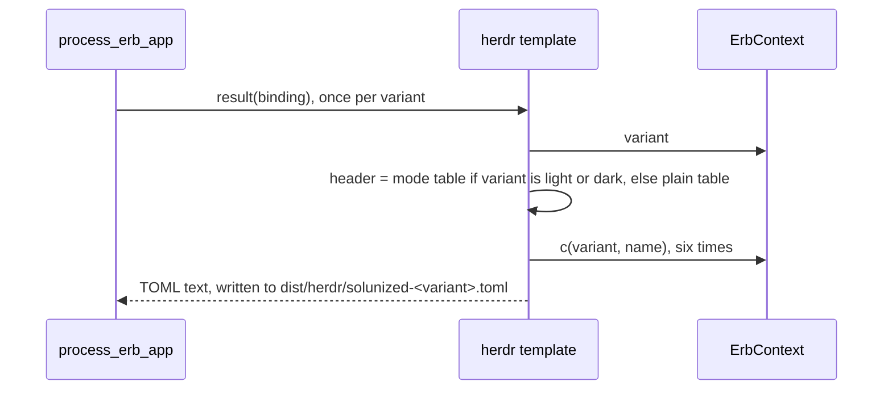

# Plan: herdr template emits mode tables

From `intent.md` (2026-11-06). Status: accepted.

## Design

### Domain terms

No `GLOSSARY.md` exists, so no avoid list applies. Terms used here (not yet agreed for the glossary):

- **Variant**: a key of `themes.yml` (`dark`, `light`, `black`, `white`). Templates read it as the ERB local `variant`, a String.
- **Card-panel tokens**: the six herdr tokens from PR #21: `accent`, `active_row_bg`, `overlay0`, `panel_bg`, `sidebar_bg`, `surface_dim`.
- **Mode table**: a herdr TOML table named `[theme.custom.light]` or `[theme.custom.dark]`, the form the dotfiles `config.toml` holds.
- **Plain table**: the `[theme.custom]` header. Black and white keep it.

### Diagrams



### Signatures

Not affected: no Ruby method is added or changed. The template uses only `variant` and `c(variant, name)`, which exist on `ErbContext` in `generate_themes.rb`.

The whole new template, `applications/herdr/template.toml.erb`:

```erb
<%# Mode tables follow the variant name, not interface_style: black and white keep the plain table. -%>
[theme.custom<%= ".#{variant}" if %w[light dark].include?(variant) %>]
accent        = "<%= c(variant, "br_orange") %>"
active_row_bg = "<%= c(variant, "bg_0") %>"
overlay0      = "<%= c(variant, "bg_2") %>"
panel_bg      = "<%= c(variant, "bg_1") %>"
sidebar_bg    = "<%= c(variant, "bg_1") %>"
surface_dim   = "<%= c(variant, "bg_1") %>"
```

The ERB comment line ends in `-%>`; `process_erb_app` uses `trim_mode: "-"`, so the comment leaves no blank line and the header is line 1 of the output.

Not checked: solunized has no Gemfile and no Steep or rbs_rails.

### Complexity

No new path. Each variant renders one template with 6 calls to `c` (was 18) and one `Array#include?` on two Strings. Generation still writes four herdr files. No database, no queries.

### Invariants

1. `solunized-light.toml` and `solunized-dark.toml` start with `[theme.custom.<variant>]`. The header expression enforces it.
2. `solunized-black.toml` and `solunized-white.toml` start with `[theme.custom]`. The header expression falls through for every other variant.
3. Every herdr file holds exactly the six card-panel tokens, in alphabetical order, each once. The template body enforces it.
4. Each token maps to its PR #21 palette name: `accent` = `br_orange`, `active_row_bg` = `bg_0`, `overlay0` = `bg_2`, `panel_bg`/`sidebar_bg`/`surface_dim` = `bg_1`. The template enforces it.
5. Every colour comes from `themes.yml`. `c(variant, name)` enforces it and raises on an unknown key.

### Alternatives

- **A. Template-only conditional (chosen).** One header expression and six token lines in the template. Only the two files the intent names change. Cost: the literal `%w[light dark]` must match the `themes.yml` keys; a renamed variant silently falls back to the plain table. The header tests name `light` and `dark` directly, so they catch that.
- **B. Data-driven variant setting (rejected).** A `variant_settings: table: {default, light, dark}` key in `applications/herdr/configuration.yml`, a new `ErbContext#setting(name)`, and new validation in `validate_app_config!`. About 20 lines of generator code, a new public method with its own tests, and a third lookup idiom for templates, for one user. It also goes past the files the intent names. Its architect recommended against it for this chore.
- **C. Header from `interface_style` via `appearance(variant)` (rejected).** It would give `black` a dark mode table and `white` a light mode table. That contradicts the intent decision "Light and dark only get mode tables, chosen by variant name". The ERB comment in the template guards against this refactor.

## Design decisions

- Token order is alphabetical, and the `=` signs are aligned at column 15, as in the dotfiles `config.toml` today (`accent        = "#a44910"`). The generated light and dark files are then byte-identical to the dotfiles tables, so the later sync changes no character, not only no colour. The intent left formatting open. This stays within the intent decision "the sync must not change any colour value".
- The `tokens_for` test helper regex changes from `/^(\w+) = "([^"]+)"$/` to `/^(\w+)\s*=\s*"([^"]+)"$/`, because of the alignment. It stays private.
- No conflict with `intent.md`'s `## Decisions`.

## Integration points

- `generate_themes.rb` `process_erb_app`: renders the template once per variant with `trim_mode: "-"`. Unchanged.
- `dist/herdr/` (gitignored). CI's `generated_files_current` job regenerates and runs `git diff --exit-code`; no committed file changes, so it stays green.
- The dotfiles repository's herdr `config.toml`: a later, separate intent copies the light and dark files into it. Nothing in dotfiles changes here.

## Files that change

- `applications/herdr/template.toml.erb` — header chosen by variant name; cut from 18 tokens to the six card-panel tokens, alphabetical and aligned.
- `test/generate_themes_test.rb` (`HerdrApplicationTest` only) — tests for the headers, the exact token set and the full light and dark file contents; `overlay0` joins `CARD_PANEL_TOKENS`.

## Order of work

1. In `HerdrApplicationTest`, write `test_light_file_is_the_light_mode_table` and `test_dark_file_is_the_dark_mode_table`. Each compares the whole generated file to a heredoc of the expected mode table. Run `ruby test/generate_themes_test.rb -n /mode_table/` and watch both fail (header and token set differ).
2. Write `test_black_and_white_keep_the_plain_table` (first line is `[theme.custom]`). It passes today; it guards invariant 2.
3. Change the `tokens_for` regex to accept aligned `=`. Add `"overlay0" => "bg_2"` to `CARD_PANEL_TOKENS` and delete `test_every_variant_keeps_overlay0_on_bg_2`, which the mapping test then covers.
4. Write `test_every_variant_holds_exactly_the_card_panel_tokens`. For every variant, read the file's lines after the header, drop blank lines, and assert that each line matches `/\A[\w-]+\s*=\s*"#[0-9a-f]{6}"\z/`. Then assert that the Array of their keys (the text before `=`, stripped) equals `CARD_PANEL_TOKENS.keys.sort`. An Array, not a Hash, so a duplicate key fails. Put the line reading in a private helper, `token_names_for(variant)`. Watch it fail.
5. Rewrite `applications/herdr/template.toml.erb` as in `### Signatures`.
6. Extend `test_light_variant_sets_the_card_panel_tokens` with `overlay0` = `#d5d2c8`, and `test_dark_variant_sets_the_card_panel_tokens` with `active_row_bg` = `#012b38` and `overlay0` = `#2a5d6e`, so both match the acceptance criteria value lists.
7. Run `ruby test/generate_themes_test.rb` and `ruby test/preview_palette_test.rb`. All green.
8. Run `ruby generate_themes.rb`. Check `head -1 dist/herdr/*.toml`. Run `git diff --exit-code -- docs/colors.md docs/slack.md` (expect exit 0, as CI's diff job), and check that `git status --porcelain` lists only `applications/herdr/template.toml.erb` and `test/generate_themes_test.rb`.
9. Evidence only, read-only, not a test: compare with the dotfiles tables. `diff <(cat dist/herdr/solunized-light.toml; echo; cat dist/herdr/solunized-dark.toml) <(awk '/^\[theme\.custom\.light\]/{p=1} /^\[ui\.toast\]/{p=0} p' ~/Developer/dotfiles/herdr/.config/herdr/config.toml | sed '$d')`. The `sed '$d'` drops the blank line before `[ui.toast]`. Expect no output. If dotfiles has moved on, report the difference; do not edit dotfiles. The drift test belongs to the later dotfiles intent.

## Risks

- Black and white lose the 12 other tokens (`surface0`, `text`, `mauve`, …). The intent accepts this: "Their token set follows the template cut". No consumer reads those files today.
- The literal `%w[light dark]` couples the template to `themes.yml` keys by meaning. A rename falls back silently to the plain table; the full-file tests catch it.
- A later edit could drop the `-` in the comment's `-%>` and put a blank line before the header. The full-file tests compare from the first byte, so they catch it.
- Alignment couples the output to the dotfiles formatting. If dotfiles reformats, the later sync shows whitespace diffs, never colour diffs.
- Rejected: data-driven settings and `interface_style` (see `### Alternatives`).

Out of scope: the dotfiles sync script, markers and drift test; any change in the dotfiles repository; any colour change or new colour; `generate_themes.rb`; other applications; the glossary (no term is agreed with Etienne in autonomous delivery).

## Proof

- `dist/herdr/solunized-light.toml` starts with `[theme.custom.light]` and holds exactly the six tokens → `test/generate_themes_test.rb` `HerdrApplicationTest#test_light_file_is_the_light_mode_table`
- `dist/herdr/solunized-dark.toml` starts with `[theme.custom.dark]` and holds the same six tokens → `test/generate_themes_test.rb` `HerdrApplicationTest#test_dark_file_is_the_dark_mode_table`
- Light values `#a44910`, `#fffbf1`, `#d5d2c8`, `#eeeae0` ×3 and dark values `#fa9253`, `#012b38`, `#2a5d6e`, `#0d3b4a` ×3 → `test/generate_themes_test.rb` `HerdrApplicationTest#test_light_file_is_the_light_mode_table`, `#test_dark_file_is_the_dark_mode_table`, `#test_light_variant_sets_the_card_panel_tokens`, `#test_dark_variant_sets_the_card_panel_tokens`
- `solunized-black.toml` and `solunized-white.toml` still start with `[theme.custom]` → `test/generate_themes_test.rb` `HerdrApplicationTest#test_black_and_white_keep_the_plain_table`
- The solunized tests pass → check: `ruby test/generate_themes_test.rb && ruby test/preview_palette_test.rb`
- Query count: not affected, no database.
- Invariant: every herdr file holds exactly the six card-panel tokens, each once, enforced by the template body → `test/generate_themes_test.rb` `HerdrApplicationTest#test_every_variant_holds_exactly_the_card_panel_tokens`
- Invariant: each token maps to its PR #21 palette name, enforced by the template → `test/generate_themes_test.rb` `HerdrApplicationTest#test_every_variant_maps_the_card_panel_tokens_to_the_same_palette_names`
- Invariant: every herdr output is generated, four files → `test/generate_themes_test.rb` `FullApplicationIntegrationTest#test_generates_real_templates_and_validates_zed_json` (unchanged)

Per changed file, the unit tests expected:
- `applications/herdr/template.toml.erb`: `light file is the light mode table`, `dark file is the dark mode table`, `black and white keep the plain table`, `every variant holds exactly the card-panel tokens`, `every variant maps the card-panel tokens to the same palette names`, `light variant sets the card-panel tokens`, `dark variant sets the card-panel tokens`.
- `test/generate_themes_test.rb`: test code only, no tests of its own.

Test setup: `HerdrApplicationTest#setup` already renders the real template against the real `themes.yml` into a tmpdir. No fixtures, no fakes. The full-file tests use a heredoc literal of the expected table.

---
Domain skills applied: software-design (alternatives, invariants), glossary (checked; no GLOSSARY.md, no terms written), diagrams (sequence diagram).

## Critique

### Round 1 (codex exec -p terra)

- Step 8 compared the output to an unspecified dotfiles TOML block, which blurs the later intent's drift-test scope → fixed (step 9 now names the exact read-only command, marked evidence only, and leaves the drift test to the later intent)
- `git status --porcelain` cannot prove regeneration left tracked outputs unchanged, since it shows the planned source edits → fixed (step 8 runs `git diff --exit-code` on the committed docs outputs and checks status lists only the two planned files)
- The token parser with `\w+` and `to_h` can hide a duplicate key or a stray line, too weak for the exactly-six invariant → fixed (step 4 checks every non-header line against the key/value grammar and compares an Array of keys, in a new private helper `token_names_for`)
