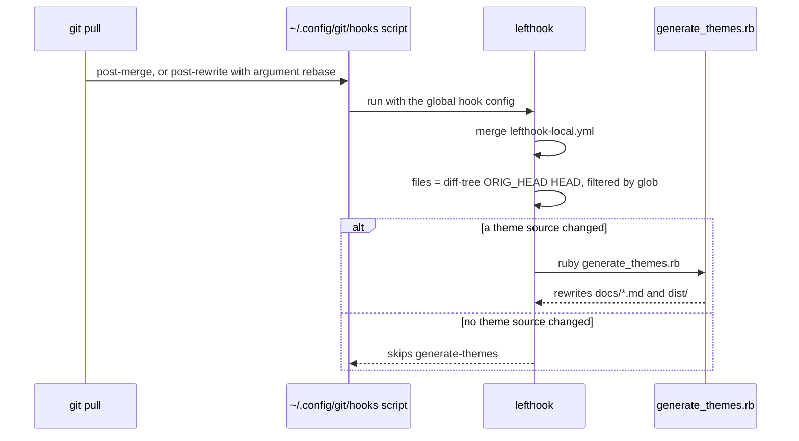
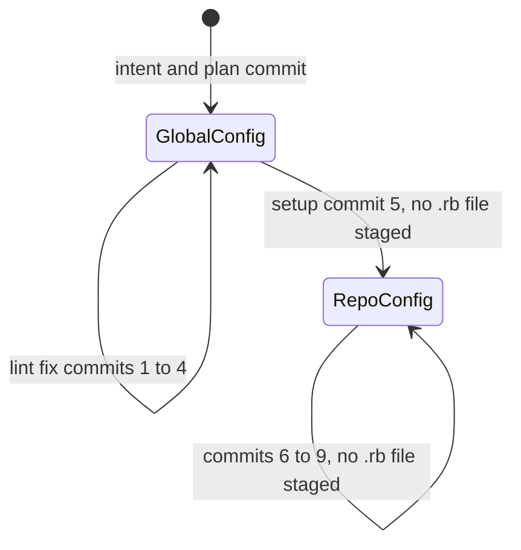
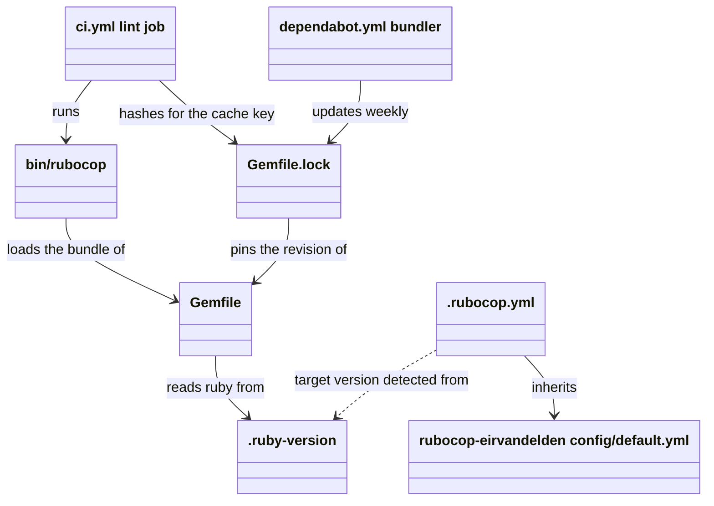

# Plan: Lefthook post-pull regeneration, RuboCop and CI lint

From `intent.md` (2026-11-06). Status: accepted (2026-11-06, agreed by Etienne; he declined the cross-model critique).

## Design

### Domain terms

No `GLOSSARY.md` exists. This change is tooling, and it adds no domain term to the theme model. The plan uses these working terms; none goes into a glossary:

- **Theme source**: `themes.yml`, or any file under `applications/`. A change to one can change a generated output.
- **Global hook config**: `~/Developer/dotfiles/lefthook.yml`. The `core.hooksPath` scripts in `~/.config/git/hooks/` set `LEFTHOOK_CONFIG` to it when the repository has no `lefthook.yml`.
- **Local hook config**: the repository-root `lefthook-local.yml`. Lefthook merges it into the global hook config.
- **Global RuboCop config**: `~/.rubocop.yml`. RuboCop uses it while the worktree has no `.rubocop.yml`.
- **Repo RuboCop config**: the new `.rubocop.yml`, which inherits `rubocop-eirvandelden`'s `config/default.yml`.
- **Scratch RuboCop config**: a file outside the worktree that holds the repo RuboCop config's rules. It lets the lint fixes be checked against the new rules before `.rubocop.yml` exists. The pre-commit hook never sees it.
- **Cop family**: one RuboCop department, for example `Minitest`, `Obsession`, `Style/RbsInline` or `Layout`.

### Diagrams

After a pull:



Which RuboCop config the pre-commit hook applies, by commit:



Which file reads which:



### Signatures

No public method is added, removed or changed. The `Style/RbsInline/MissingTypeAnnotation` fix adds one `#:` comment above each public method. These are the intended types; keep each comment line at 120 characters or fewer (drop parameter names where a line would be longer), and use `untyped` only for raw YAML before validation.

`generate_themes.rb` — top-level helpers and `ErbContext`, the binding that the ERB templates run in:

- `load_yaml_hash` — `#: (String path) -> Hash[untyped, untyped]`
- `validate_themes!` — `#: (String themes_yml, untyped themes) -> void`
- `validate_app_config!` — `#: (String app_file, untyped raw_config) -> [String, Hash[String, untyped], String]`
- `erb_template_for` — `#: (String app_file) -> String?`
- `hex_to_oklch` — `#: (String hex) -> String`
- `hex_to_term_color` — `#: (String hex, ?plutil_command: String, ?env: Hash[String, String]) -> String`
- `convert_plist_xml_to_binary` — `#: (String xml, plutil_command: String, ?env: Hash[String, String]) -> String`
- `ErbContext#initialize` — `#: (Hash[String, untyped], ?String?, ?Hash[String, untyped]?, ?plutil_command: String, ?plutil_env: Hash[String, String]) -> void`
- `ErbContext` readers — split `attr_reader :themes, :variant, :theme_data` into three lines, because the types differ: `attr_reader :themes #: Hash[String, untyped]`, `attr_reader :variant #: String?`, `attr_reader :theme_data #: Hash[String, untyped]?`
- `ErbContext#c` — `#: (String | Symbol v, String | Symbol name) -> String`
- `ErbContext#appearance` — `#: (String | Symbol v) -> String?`
- `ErbContext#hex_to_term_color` — `#: (String hex) -> String`
- `ErbContext#get_binding` — `#: () -> Binding`
- `process_erb_app` — `#: (Hash[String, untyped], Hash[String, untyped], String, ?plutil_command: String, ?plutil_env: Hash[String, String]) -> void`
- `process_all_apps` — `#: (themes_yml: String, apps_dir: String, ?plutil_command: String, ?plutil_env: Hash[String, String]) -> void`

`preview_palette.rb` — `PreviewPalette` prints a variant's colours on its own background:

- `PreviewPalette.render` — `#: (String variant, Hash[String, String] colors) -> String`
- `PreviewPalette.colors_for` — `#: (String variant, String path) -> Hash[String, String]`

`Style/RbsInline/InvalidTypes` parses each comment, so a malformed type fails `bin/rubocop`.

Not checked: solunized has no Steep, and adding it is a dependency outside this intent.

### Complexity

- A pull that changes a theme source: one generator run (every app, every variant), in parallel with the global `migrations` and `sweep-worktrees` commands. The generator loads no gem, so it does not wait for `bi`.
- A pull that changes no theme source: no extra process. The global config already runs `git diff-tree`; the glob match is linear in the changed files.
- CI lint job: one gem install (cached by `setup-rv`), then RuboCop over five Ruby files (`generate_themes.rb`, `preview_palette.rb`, two test files, `Gemfile`).
- The split integration test runs `process_all_apps` three times instead of once: about two extra full generations per test run.
- No database, no queries.

### Invariants

- I1: a pull that changes no theme source never runs the generator. Enforced by `glob` plus `: {files}` in `lefthook-local.yml`.
- I2: a pull, or a `pull --rebase`, that changes `themes.yml` or `applications/**` runs the generator. Enforced by the two `generate-themes` commands.
- I3: `post-rewrite` runs the generator only when its first argument is `rebase`, so `commit --amend` with a stale `ORIG_HEAD` never runs it. Enforced by the `[ {1} = rebase ] || exit 0` guard.
- I4: no linter disable of any kind: no `rubocop:disable` comment, no `# rbs_inline: disabled`, no `.rubocop_todo.yml`, no `Exclude:` or cop override in `.rubocop.yml`, no hook bypass (`--no-verify`, `LEFTHOOK=0`, `LEFTHOOK_EXCLUDE`). Enforced by review and by the consent guard for `--no-verify`.
- I5: no `.rubocop.yml` and no `Gemfile` exist on disk while lint commits 1 to 4 are made, so the pre-commit hook applies the global RuboCop config and autocorrects nothing into them. Enforced by a guard command before each of those commits.
- I6: every commit leaves both test files green and `ruby generate_themes.rb` leaves `git status` clean. Enforced by a check after each commit, and by the unchanged CI `test` and `generated_files_current` jobs.
- I7: the CI lint job lands only once `bin/rubocop` exits 0 on the whole repository. Enforced by the gate in step 7.

### Alternatives

- **A. Setup first, then fixes.** Add `Gemfile`, `.rubocop.yml` and `bin/rubocop` first, then fix offenses. Rejected: the pre-commit hook runs `rubocop -a` with `stage_fixed: true`, and RuboCop reads `.rubocop.yml` from disk. The first commit that stages `test/generate_themes_test.rb` would have to clear all its families at once, and the hook would autocorrect and stage the rest into it. Per-family commits collapse into one commit per file.
- **B. Fixes first under the global config, setup after (chosen).** Under the global RuboCop config the test files have no offenses, so each test-file family commits on its own. The lib files fail the global config only on `Style/RbsInline` and `Layout`. The scratch RuboCop config checks every fix against the new rules. Cost: until the setup commit, the hook does not check the new rules, so the step-7 gate catches anything the scratch check missed.
- **C. A repository `lefthook.yml` with `extends:`, or a `bin/regenerate` wrapper.** Rejected: the intent puts a repo `lefthook.yml` out of scope, and a wrapper adds a file that hides one command.

## Design decisions

- `TargetRubyVersion` is not written in `.rubocop.yml`. RuboCop reads it from `.ruby-version` (4.0.7 gives 4.0) when the config sets none, which keeps `.ruby-version` the one place for the version. This is the literal reading of the intent's "TargetRubyVersion from `.ruby-version`". Step 7 checks that RuboCop resolves 4.0; if it does not, add `AllCops: TargetRubyVersion: 4.0` and say so in the commit.
- `lefthook-local.yml` is tracked with `git add -f`. The global gitignore (`~/.config/git/ignore.global`, line 193) lists the name. `~/Developer/dotfiles` and `~/Developer/journal_administration` already track theirs the same way.
- `post-rewrite` gets the `[ {1} = rebase ] || exit 0` guard. Verified in a scratch repository: without it, `commit --amend` runs the generator when a stale `ORIG_HEAD` differs on a theme source.
- `preview_palette.rb`'s two `Layout/SpaceInsideArrayLiteralBrackets` fixes share a commit with its `Style/RbsInline` fix. The hook forces this: a Layout-only commit fails on the RbsInline offenses, which cannot be autocorrected, and an RbsInline-only commit gets the Layout fix autocorrected and staged into it. This is the one deviation from "separate commits per cop family"; the commit message names both cops and the reason.
- `Minitest/AssertTruthy` at `test/generate_themes_test.rb:133` becomes `assert_same true, comment.fetch("italic")`, not the cop's unsafe `assert comment.fetch("italic")`. Glow needs a JSON boolean, and `assert_same` keeps the strict check. If a cop flags `assert_same true`, fall back to `assert comment.fetch("italic")` plus `assert_instance_of TrueClass, comment.fetch("italic")`.
- `Minitest/MultipleAssertions` (the 13-assertion test at line 810) is fixed by splitting the test into three, each calling `process_all_apps` once: single-file outputs (6 path checks), per-variant outputs including no Terminal output without plutil (5 assertions), Zed JSON validity (2 assertions). Raising `Max` is a cop override and is forbidden by I4.
- `lefthook-local.yml` lands late (commit 8), so its `post-rewrite` hook is not live while the lint commits are made.
- The CI lint job copies appkit's `rails-ci.yml` `lint` job, with exact action versions (this repo pins `actions/checkout@v7.0.1`; `actions/cache` latest is `v6.1.0`), and drops `**/.rubocop_todo.yml` from `hashFiles` because no todo file may exist.
- The test jobs keep plain `ruby` and no `install-gems`; the tests load no gem from the `Gemfile`.

No step contradicts the intent's `## Decisions`.

## Integration points

- Global hooks: `~/.config/git/hooks/*` and `~/Developer/dotfiles/lefthook.yml`. The global `post-merge` sets `files: git diff-tree -r --name-only --no-commit-id ORIG_HEAD HEAD` and `skip: [rebase]`; `post-rewrite` sets the same `files`. The local commands inherit `files`. Verified with `lefthook dump` (lefthook 2.2.2).
- The global `migrations` → `bundle` command already runs `bi` after a pull that changes `Gemfile*`, so the new gem installs on the maintainer's machines without extra config.
- The global pre-commit `rubocop` job (`rubocop -a --force-exclusion {staged_files}`, `stage_fixed: true`) and pre-push `rubocop` and `bundle-audit` jobs start to use the repo RuboCop config once `.rubocop.yml` exists. Verified: the global `rubocop` resolves a GitHub-sourced `inherit_gem` in a repository with a `Gemfile` (`~/Developer/journal_administration`).
- GitHub Actions: `spinel-coop/setup-rv@main` with `install-gems: true`, `actions/cache@v6.1.0`, on `ubuntu-slim`.
- Dependabot: a new `bundler` ecosystem.
- `rubocop-eirvandelden` from GitHub (`eirvandelden/rubocop-eirvandelden`, main at `32d259fcdc1e7ae80c01fc95815768a534d77e2e` on 2026-11-06).

## Files that change

- `test/generate_themes_test.rb` — Minitest fixes (`AssertPathExists` 8, `AssertTruthy` 1, `MultipleAssertions` split, `EmptyLineBeforeAssertionMethods`), then `Obsession/MethodOrder` (helpers `colours_in` at line 191 and `tokens_for` at line 727 move; bodies unchanged).
- `generate_themes.rb` — `#:` signatures on 15 public members; `attr_reader` split into three lines.
- `preview_palette.rb` — `#:` signatures on `render` and `colors_for`; array bracket spacing at line 16.
- `Gemfile` — new:

  ```ruby
  source "https://gem.coop"

  ruby file: ".ruby-version"

  group :development do
    gem "rubocop-eirvandelden", github: "eirvandelden/rubocop-eirvandelden", require: false
  end
  ```

- `Gemfile.lock` — new, generated by `bi`, then `bundle lock --add-platform x86_64-linux` when `PLATFORMS` lacks it. Never written by hand.
- `.rubocop.yml` — new:

  ```yaml
  ---
  # The rules shared by every personal Ruby project
  inherit_gem:
    rubocop-eirvandelden:
      - config/default.yml
  ```

- `bin/rubocop` — new, mode 100755, a copy of `~/Developer/journal_administration/bin/rubocop` (the Bundler binstub). `default.yml` excludes `bin/**/*`.
- `.github/workflows/ci.yml` — new `lint` job after `generated_files_current`; the other jobs do not change:

  ```yaml
    lint:
      name: Lint
      runs-on: ubuntu-slim
      env:
        RUBOCOP_CACHE_ROOT: tmp/rubocop

      steps:
        - name: Checkout code
          uses: actions/checkout@v7.0.1

        - name: Set up Ruby
          uses: spinel-coop/setup-rv@main
          with:
            ruby-version: current
            install-gems: true

        - name: Prepare RuboCop cache
          uses: actions/cache@v6.1.0
          env:
            DEPENDENCIES_HASH: ${{ hashFiles('.ruby-version', '.rubocop.yml', 'Gemfile.lock') }}
          with:
            path: ${{ env.RUBOCOP_CACHE_ROOT }}
            key: rubocop-${{ runner.os }}-${{ env.DEPENDENCIES_HASH }}-${{ github.ref_name == github.event.repository.default_branch && github.run_id || 'default' }}
            restore-keys: |
              rubocop-${{ runner.os }}-${{ env.DEPENDENCIES_HASH }}-

        - name: Lint Ruby with RuboCop
          run: bin/rubocop -f github
  ```

- `.github/dependabot.yml` — new entry before `github-actions`:

  ```yaml
    - package-ecosystem: bundler
      directory: "/"
      schedule:
        interval: weekly
      cooldown:
        default-days: 7
  ```

- `lefthook-local.yml` — new, staged with `git add -f`:

  ```yaml
  ---
  # Regenerate the themes after a pull that changes themes.yml or applications/.
  # The global config sets `files` to the pulled change. Lefthook applies `glob`
  # only when `run` holds a file template, so `: {files}` passes it to a no-op.
  post-merge:
    commands:
      generate-themes:
        glob:
          - "themes.yml"
          - "applications/**"
        run: ": {files}; ruby generate_themes.rb"

  # post-rewrite also fires on `commit --amend`, where ORIG_HEAD can be stale.
  post-rewrite:
    commands:
      generate-themes:
        glob:
          - "themes.yml"
          - "applications/**"
        run: "[ {1} = rebase ] || exit 0; : {files}; ruby generate_themes.rb"
  ```

- `AGENTS.md` — Commands: the test bullet says the tests load no gem, so plain `ruby` and no `bundle exec`; replace "No linter is configured" with `bin/rubocop` (lint with `rubocop-eirvandelden`; install the one gem with `bi`; CI's `lint` job runs `bin/rubocop -f github`). Gotchas: add that `lefthook-local.yml` runs `ruby generate_themes.rb` after a pull or `pull --rebase` that changes `themes.yml` or `applications/**`, and that it is tracked although the global gitignore lists its name.

## Order of work

No acceptance criterion needs a new test: the hooks, Gemfile, RuboCop and CI files are configuration, and the Ruby edits change no behaviour. Each criterion has a check instead (see `## Proof`). Run the narrowest check first.

1. Prepare. Confirm `pwd` is the worktree and `test ! -e .rubocop.yml && test ! -e Gemfile`. Write the scratch RuboCop config outside the worktree (for example in the session scratchpad):

   ```yaml
   inherit_gem:
     rubocop-eirvandelden:
       - config/default.yml
   AllCops:
     TargetRubyVersion: 4.0
   ```

   Define `scratch_rubocop` as `BUNDLE_GEMFILE=$HOME/Developer/journal_administration/Gemfile bundle exec rubocop -c <scratch config> --cache false`. That bundle already pins `rubocop-eirvandelden` at `32d259f`. Baseline: `scratch_rubocop --format offenses` reports 43 offenses in 7 cops.
2. Commit 1, `Fix Minitest offenses in generate_themes tests` (`test/generate_themes_test.rb`): `AssertPathExists`, `AssertTruthy` (as `## Design decisions` says), the `MultipleAssertions` split, then `EmptyLineBeforeAssertionMethods` last so it covers the new tests. Check: `scratch_rubocop --only Minitest test/generate_themes_test.rb` reports 0; bare `rubocop test/generate_themes_test.rb` reports 0; both test files pass. Then commit. Before every lint commit (1 to 4), re-run `test ! -e .rubocop.yml && test ! -e Gemfile`, and stage only whole files whose edits all belong to that commit.
3. Commit 2, `Fix Obsession/MethodOrder in generate_themes tests`: move `colours_in` and `tokens_for`. Check `scratch_rubocop --only Obsession test/generate_themes_test.rb` reports 0 and the tests pass.
4. Commit 3, `Add RBS inline signatures to generate_themes.rb`: the 15 signatures and the `attr_reader` split. Check `scratch_rubocop generate_themes.rb` reports 0, bare `rubocop generate_themes.rb` reports 0, the tests pass and `ruby generate_themes.rb` leaves `git status` clean.
5. Commit 4, `Add RBS inline signatures and array bracket spacing to preview_palette.rb`: both cops, with the reason from `## Design decisions` in the message body. Check `scratch_rubocop preview_palette.rb` reports 0 and `ruby test/preview_palette_test.rb` passes.
6. Check `scratch_rubocop` on the whole repository reports 0 offenses.
7. Commit 5, `Add RuboCop with rubocop-eirvandelden`: write `Gemfile`, run `bi`, run `bundle lock --add-platform x86_64-linux` if `PLATFORMS` lacks it, write `.rubocop.yml`, copy `bin/rubocop` and `chmod +x` it. Gate: `bin/rubocop` exits 0 (this also lints `Gemfile`); `bundle exec ruby -e 'require "rubocop"; puts RuboCop::ConfigStore.new.for_pwd.target_ruby_version'` prints 4.0; `git ls-files -s bin/rubocop` shows 100755 after staging. A leftover offense gets its own commit, named after its cop, before step 8.
8. Commit 6, `Add RuboCop lint job to CI`: `.github/workflows/ci.yml`. Check yamllint passes (line-length warnings are allowed).
9. Commit 7, `Add bundler to Dependabot`: `.github/dependabot.yml`.
10. Commit 8, `Regenerate themes after a pull that changes them`: write `lefthook-local.yml`, `git add -f lefthook-local.yml`, commit. Then run the hook checks in `## Proof`.
11. Commit 9, `docs: AGENTS.md for the Gemfile, RuboCop and post-pull regeneration`: `AGENTS.md`.
12. Final: both test files pass; `ruby generate_themes.rb` leaves `git status` clean; `bin/rubocop` exits 0; `grep -rn "rubocop:disable\|rbs_inline: disabled" --include=*.rb .` is empty; no `.rubocop_todo.yml`; re-read the full diff against `main`.

## Risks

- The step-7 gate is the first time the real `.rubocop.yml` meets the code. The scratch check uses `journal_administration`'s bundle; if that bundle drifts from the GitHub ref, leftovers appear here and get their own commit.
- `Gemfile.lock` without a Linux platform can fail `setup-rv`'s gem install on `ubuntu-slim`. Step 7 adds `x86_64-linux`.
- Dependabot must handle `ruby file:`, the `gem.coop` source and a `github:` gem. If it cannot, only Dependabot's own pull requests fail. Look at the first run.
- A pull that brings a broken `themes.yml` makes the generator raise in the post-merge hook. The pull is not undone; the committed outputs stay as they were, and CI's diff job still catches a mismatch.
- `lefthook-local.yml` is meant as a per-machine override by lefthook convention; this repo tracks it on purpose (intent constraint). A future `git clean -X` or a fresh copy needs `git add -f`.
- The CI lint job cannot be shown failing before the pull request exists: CI runs on `pull_request` and on pushes to `main` only. The proof is the local exit status of the same command plus the job going green on the pull request.
- Rejected: Alternatives A and C above; a YAML anchor shared by both hook commands (clever for eight lines, and unlike the global file); `minitest` or `base64` in the `Gemfile` (the tests run under plain `ruby` today).

## Proof

Acceptance criteria — all checks, because no criterion adds behaviour a test could pin. The hook checks run in a scratch directory outside the worktree, against fresh clones of this branch (`git clone --branch lefthook-rubocop-ci <worktree path> up`, then `git clone up down`, with `git -C down config pull.rebase false`). Each check uses a fresh `down` clone; `dist/` is gitignored, so it exists in `down` only if the generator ran. Fixture commits in `up` run the normal hooks (the branch is not `main`).

- A pull that brings in a changed `themes.yml` regenerates `docs/colors.md` and `docs/slack.md` → check: in `up`, change one hex value in `themes.yml` and commit it without regenerating; in `down`, `git pull`; then `test -d dist` and `git -C down status --short docs/` lists `docs/colors.md`.
- A pull that changes only `README.md` does not run the generator → check: in `up`, commit a `README.md` change; in a fresh `down`, `git pull`; then `test ! -e dist` and the pull output has no `Processing application`.
- The same holds for a `pull --rebase` → check: in a fresh `down` with one local commit, `git pull --rebase` of a `themes.yml` change gives `test -d dist`; in another fresh `down` with one local commit, `git pull --rebase` of a `README.md` change gives `test ! -e dist`.
- Invariant: `commit --amend` never runs the generator, enforced by the `post-rewrite` guard → check: after the `themes.yml` `pull --rebase` check, `rm -rf dist`, `git checkout docs`, `git commit --amend --no-edit`; then `test ! -e dist`.
- `rubocop` exits 0 on the repository, locally and in CI → check: `bin/rubocop; echo $?` prints 0; the `Lint` job is green on the pull request.
- A pull request with a RuboCop offense fails the CI lint job → check: write `lint_probe.rb` holding `puts 'single quotes'` in the worktree; `bin/rubocop -f github lint_probe.rb; echo $?` prints an `::error` line and 1; delete the file. The `Lint` job's last step runs exactly that command, so a non-zero exit fails the job.
- `ruby generate_themes.rb` leaves `git status` clean, and both test files stay green → check: `ruby generate_themes.rb && git status --porcelain` prints nothing; `ruby test/generate_themes_test.rb` and `ruby test/preview_palette_test.rb` pass. After every commit.
- Invariant: no linter disable, enforced by review → check: the step-12 grep is empty and `.rubocop.yml` holds only `inherit_gem`.
- Invariant: RuboCop's target version is 4.0, enforced by `.ruby-version` detection → check: the step-7 target-version command shows 4.0.

Per changed file, the unit tests expected:

- `test/generate_themes_test.rb`: the split of `test_generates_real_templates_and_validates_zed_json` into `test_writes_every_single_file_output`, `test_writes_one_file_per_variant_and_skips_terminal_without_plutil` and `test_zed_output_is_valid_json_with_four_themes`, all passing. No other test changes meaning.
- `generate_themes.rb`, `preview_palette.rb`: no new tests; the existing tests stay green.

Test setup: the existing `FullApplicationIntegrationTest` setup (a temporary directory and copied `applications/`) serves the three split tests. The hook checks use throwaway clones in a scratch directory.

Out of scope: `erb_lint`; Rails and Capybara cop layers; the custom `Locale/LiteralMessage` cop; a repository `lefthook.yml` and the `lefthook` gem; Steep; any change to the generator's behaviour or output; `rescue => e` renames (no cop flags them).

---
Domain skills applied: dependencies, software-design, diagrams, glossary, object-oriented-design (no class changes), ruby-style (signature comments).
